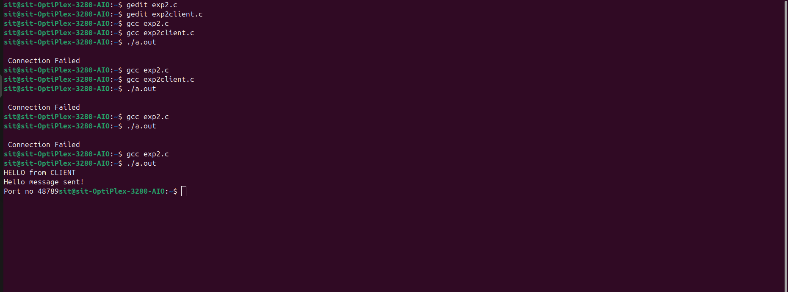

# Experiment 02: TCP Server Socket Programming

## 1. Experiment Title
Implementation of a Connection-Oriented TCP Server Using Berkeley Sockets in C.

---

## 2. Aim
To design, implement, and analyze a connection-oriented TCP server in C using the POSIX socket API. The server must create a stream socket, bind it to an IPv4 address and port `8080`, listen for incoming connection requests, accept an incoming connection from a TCP client, receive a client message, send a reply, print the client's ephemeral port, and terminate the session gracefully.

---

## 3. Theory / Introduction
The Transmission Control Protocol (TCP) is a core transport-layer protocol providing reliable, ordered, error-checked, and stream-oriented delivery of octets between networked applications.

### 3.1 Key Characteristics of TCP
- **Connection-Oriented:** A dedicated logical connection is established via a three-way handshake ($SYN \rightarrow SYN+ACK \rightarrow ACK$) before any user payload is transmitted.
- **Reliability:** Employs sequence numbers, cumulative acknowledgements (ACK), and retransmission timers to guarantee data delivery without loss or duplication.
- **Flow Control:** Implements a sliding window mechanism where the receiver advertises its available buffer capacity in the window field.
- **Congestion Control:** Regulates injection rate into the network using slow start, congestion avoidance, fast retransmit, and fast recovery algorithms.

### 3.2 TCP Server Socket Lifecycle

```
        socket()           --> Create endpoint (AF_INET, SOCK_STREAM)
           |
       setsockopt()        --> Enable SO_REUSEADDR / SO_REUSEPORT
           |
         bind()            --> Bind to IP (INADDR_ANY) and Port (8080)
           |
        listen()           --> Enter passive listening state with backlog
           |
        accept()           --> Blocks until incoming SYN arrives; creates new socket FD
           |
         read()            --> Receives data sent by client
           |
         send()            --> Transmits response data to client
           |
         close()           --> Closes connection and sends FIN packet
```

### 3.3 Core System Calls Used
- `socket(int domain, int type, int protocol)`: Allocates a socket descriptor. Domain `AF_INET` designates IPv4; `SOCK_STREAM` specifies a reliable two-way connected byte stream (TCP).
- `setsockopt(int sockfd, int level, int optname, const void *optval, socklen_t optlen)`: Sets socket options. Setting `SO_REUSEADDR` allows the local address to be reused immediately without waiting for the `TIME_WAIT` socket state to expire.
- `bind(int sockfd, const struct sockaddr *addr, socklen_t addrlen)`: Associates the socket descriptor with a specific local IP address and port number.
- `listen(int sockfd, int backlog)`: Marks the socket as passive to accept incoming connections. The `backlog` argument sets the maximum length of the queue of pending connections.
- `accept(int sockfd, struct sockaddr *addr, socklen_t *addrlen)`: Extracts the first connection request on the queue of pending connections for the listening socket, creates a new connected socket descriptor (`new_socket`), and returns it.
- `read()` / `send()`: Performs input/output over the established stream.

---

## 4. Objectives
1. Understand the socket programming abstraction in UNIX/Linux environments.
2. Master the sequential workflow of server-side TCP socket system calls.
3. Observe port binding, passive socket listening, and client connection acceptance.
4. Verify end-to-end data transfer between separate client and server processes.

---

## 5. Required Software and Tools
- **Operating System:** Linux (Ubuntu 20.04/22.04/24.04), WSL (Windows Subsystem for Linux), or any POSIX-compliant UNIX environment.
- **Compiler:** GCC (GNU Compiler Collection).
- **Text Editor / IDE:** Gedit, Nano, Vim, or Visual Studio Code.
- **Terminal:** Bash / GNOME Terminal / Windows Terminal.

---

## 6. Algorithm / Working Principle
1. Start the program.
2. Create an IPv4 TCP stream socket using `socket(AF_INET, SOCK_STREAM, 0)`.
3. If socket creation fails, print an error using `perror()` and terminate.
4. Set `SO_REUSEADDR` and `SO_REUSEPORT` socket options to enable rapid port re-binding.
5. Populate the `sockaddr_in` structure:
   - Set `sin_family = AF_INET`.
   - Set `sin_addr.s_addr = INADDR_ANY` (accept connections on all local interfaces).
   - Set `sin_port = htons(PORT)` (convert host port 8080 to network byte order).
6. Bind the socket using `bind()`.
7. Put the socket in listening mode with a backlog queue of 3 using `listen()`.
8. Block and wait for an incoming connection from a client using `accept()`.
9. Upon connection, retrieve the client's socket descriptor and address parameters.
10. Read the client's message using `read()` into a buffer and display it on the terminal.
11. Send a response string (`"Hello from server"`) back to the client using `send()`.
12. Display the client's ephemeral port number (`ntohs(address.sin_port)`).
13. Close the connected socket and the master listening socket.
14. End the program.

---

## 7. Implementation Details
The server implementation is located in [tcp_server.c](file:///C:/Users/Dipali/Downloads/cn%20lab/Computer-Networks-Lab/Experiment-02-TCP-Server/tcp_server.c).

- **Port Number:** 8080
- **Buffer Size:** 1024 bytes
- **Socket Family:** AF_INET (IPv4)
- **Socket Type:** SOCK_STREAM (TCP)

---

## 8. Source Code Explanation
- `#include <sys/socket.h>` and `#include <netinet/in.h>`: Provide declarations for socket functions, socket structures (`struct sockaddr_in`), and internet protocol constants.
- `htons(PORT)`: "Host to Network Short" converts 16-bit port integers from little-endian host architecture to big-endian network byte order.
- `INADDR_ANY`: Allows the server to bind to `0.0.0.0`, listening on loopback (`127.0.0.1`) as well as all active physical and wireless network interfaces.
- `accept()`: Generates a distinct connected socket descriptor (`new_socket`) dedicated solely to communication with the connected client, leaving the original `server_fd` free to accept further connections.
- `ntohs(address.sin_port)`: Converts the client's dynamically assigned ephemeral port back to host byte order for display.

---

## 9. Step-by-Step Execution Instructions

### Step 1: Open Terminal
Open a Linux or WSL terminal and navigate to the experiment directory:
```bash
cd Experiment-02-TCP-Server
```

### Step 2: Compile the Server Code
Compile using `gcc`:
```bash
gcc tcp_server.c -o server
```

### Step 3: Run the Server
Launch the compiled binary:
```bash
./server
```
*The server will block at `accept()` awaiting a connection from the client.*

### Step 4: Run the Client (in a separate terminal)
Navigate to `Experiment-03-TCP-Client` and run the client binary:
```bash
./client
```

---

## 10. Sample Input
- Incoming client message sent across socket: `"HELLO from CLIENT"`

---

## 11. Expected Output

```text
HELLO from CLIENT
Hello message sent!
Port no 48789
```

### Screenshot Reference


---

## 12. Output Explanation
- `HELLO from CLIENT`: The text payload transmitted by the client over the established TCP stream, read into the buffer via `read()`, and printed to standard output.
- `Hello message sent!`: Confirmation that the server executed `send()` to return the greeting `"Hello from server"` to the client.
- `Port no 48789`: The ephemeral port number assigned dynamically by the operating system to the client process for this TCP session.

---

## 13. Result / Conclusion
A connection-oriented TCP server was successfully implemented in C using POSIX stream sockets. The program demonstrated reliable socket creation, port binding, passive connection listening, client acceptance, bidirectional data exchange, and graceful socket shutdown.

---

## 14. Important Viva Questions with Answers

### Q1: What is the purpose of the `listen()` system call in a TCP server?
**Answer:** `listen()` converts an active socket created by `socket()` into a passive socket that can accept incoming connection requests from clients. It also specifies the `backlog` parameter, which defines the maximum number of pending connections queued before incoming requests are refused.

### Q2: Why does `accept()` create a second socket descriptor?
**Answer:** `accept()` returns a new socket descriptor dedicated specifically to the established client connection for reading and writing data. The original listening socket (`server_fd`) remains untouched and continues listening for other incoming connection requests, enabling concurrent or iterative connection handling.

### Q3: What is the significance of `htons()` and `ntohs()`?
**Answer:** Network protocols require data to be transmitted in Big-Endian format (Network Byte Order). x86/x64 host architectures typically store data in Little-Endian format (Host Byte Order). `htons()` (Host to Network Short) and `ntohs()` (Network to Host Short) convert 16-bit integer values (like port numbers) between these representations.

### Q4: Why is `setsockopt` with `SO_REUSEADDR` needed?
**Answer:** When a TCP server shuts down, the bound local port enters the `TIME_WAIT` state for a duration of $2 \times \text{MSL}$ (Maximum Segment Lifetime). Without `SO_REUSEADDR`, restarting the server immediately causes `bind()` to fail with the error `Address already in use`.

### Q5: What happens during the TCP three-way handshake?
**Answer:**
1. **SYN:** Client sends a SYN packet with an initial sequence number ($ISN_C$).
2. **SYN-ACK:** Server responds with a SYN-ACK containing its own $ISN_S$ and acknowledges $ISN_C + 1$.
3. **ACK:** Client sends an ACK acknowledging $ISN_S + 1$. Both endpoints transition to the `ESTABLISHED` state.
