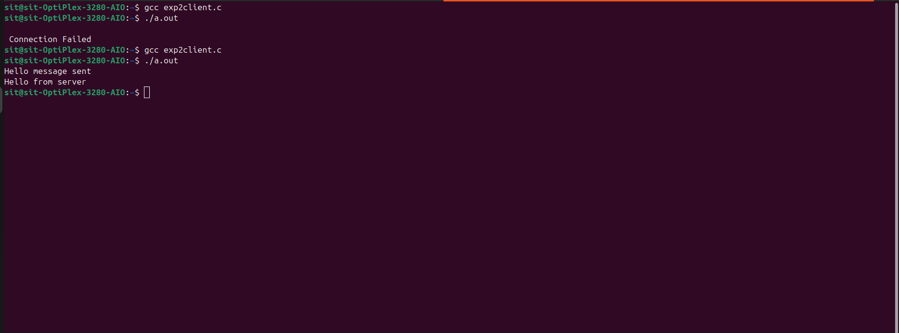

# Experiment 03: TCP Client Socket Programming

## 1. Experiment Title
Implementation of a Connection-Oriented TCP Client Using Berkeley Sockets in C.

---

## 2. Aim
To design, implement, and analyze an active TCP client program in C using POSIX stream sockets. The client must establish a connection with the TCP server listening on loopback IP `127.0.0.1` and port `8080`, transmit a client greeting message (`"HELLO from CLIENT"`), wait for and display the server's response (`"Hello from server"`), and terminate the connection cleanly.

---

## 3. Theory / Introduction
While a TCP server performs a **passive open** by binding to a port and waiting for incoming requests, a TCP client initiates an **active open** by requesting a connection to a specific remote server IP address and port number.

### 3.1 TCP Client Socket Lifecycle

```
        socket()           --> Create endpoint (AF_INET, SOCK_STREAM)
           |
       inet_pton()         --> Convert "127.0.0.1" from text to binary network format
           |
        connect()          --> Initiates 3-way handshake (SYN) to Server (127.0.0.1:8080)
           |
         send()            --> Transmits payload ("HELLO from CLIENT")
           |
         read()            --> Awaits and receives response from server
           |
         close()           --> Sends FIN segment and terminates connection
```

### 3.2 Key System Calls and Functions
- `socket(AF_INET, SOCK_STREAM, 0)`: Allocates an active stream socket descriptor for IPv4 communication.
- `inet_pton(int af, const char *src, void *dst)`: "Internet Presentation to Numeric" converts a human-readable IPv4 dotted-decimal string (such as `"127.0.0.1"`) into binary form in network byte order stored in `in_addr`.
- `connect(int sockfd, const struct sockaddr *addr, socklen_t addrlen)`: Connects the socket referred to by `sockfd` to the address specified by `addr`. This triggers the kernel to:
  1. Assign an unused ephemeral port (e.g., `48789`) from the local operating system range.
  2. Initiate the TCP three-way handshake by transmitting a SYN segment.
  3. Block until the SYN+ACK arrives from the server and the ACK is transmitted, placing the socket into the `ESTABLISHED` state.
- `send()` and `read()`: Transmit and receive payloads through the established full-duplex byte stream.
- `close()`: Releases the socket descriptor and triggers the four-way connection teardown sequence ($FIN \rightarrow ACK \rightarrow FIN \rightarrow ACK$).

---

## 4. Objectives
1. Understand the client-side socket creation and connection lifecycle.
2. Differentiate between active open (client) and passive open (server).
3. Verify IPv4 address conversion using `inet_pton()`.
4. Observe proper error handling when the target server is unreachable (`Connection Failed`).

---

## 5. Required Software and Tools
- **Operating System:** Linux (Ubuntu 20.04/22.04/24.04), WSL (Windows Subsystem for Linux), or any POSIX-compliant UNIX environment.
- **Compiler:** GCC (GNU Compiler Collection).
- **Text Editor / IDE:** Gedit, Nano, Vim, or Visual Studio Code.
- **Terminal:** Bash / GNOME Terminal / Windows Terminal.

---

## 6. Algorithm / Working Principle
1. Start the program.
2. Create an IPv4 TCP stream socket using `socket(AF_INET, SOCK_STREAM, 0)`.
3. If socket creation returns a negative value, print an error and terminate.
4. Initialize the `sockaddr_in serv_addr` structure:
   - Set address family `sin_family = AF_INET`.
   - Set destination port `sin_port = htons(PORT)`.
5. Convert the destination IP string (`"127.0.0.1"`) to binary using `inet_pton()`. If invalid or unsupported, print an error and terminate.
6. Initiate a connection to the server using `connect()`.
   - If the server is offline or unreachable, `connect()` returns `-1`, prints `"Connection Failed"`, and exits.
7. Upon successful connection establishment, transmit the message `"HELLO from CLIENT"` using `send()`.
8. Print confirmation: `"Hello message sent"`.
9. Block and read the incoming response from the server using `read()`.
10. Null-terminate the received buffer and print the message to standard output.
11. Close the socket descriptor using `close()`.
12. End the program.

---

## 7. Implementation Details
The client implementation is located in [tcp_client.c](file:///C:/Users/Dipali/Downloads/cn%20lab/Computer-Networks-Lab/Experiment-03-TCP-Client/tcp_client.c).

- **Target Server IP:** `127.0.0.1` (IPv4 Loopback)
- **Target Server Port:** `8080`
- **Buffer Size:** 1024 bytes
- **Socket Family:** AF_INET (IPv4)
- **Socket Type:** SOCK_STREAM (TCP)

---

## 8. Source Code Explanation
- `inet_pton()`: Replaces obsolete functions like `inet_addr()` or `inet_aton()`, providing robust support for standard address formats and IPv6 compatibility.
- `connect()`: The client does not call `bind()` explicitly. Instead, the operating system kernel automatically binds the socket to an ephemeral local port upon calling `connect()`.
- Error Checking: If `connect()` fails (e.g., if the server is not yet running), the program prints `Connection Failed` rather than crashing, illustrating proper network fault handling.

---

## 9. Step-by-Step Execution Instructions

### Step 1: Ensure Server is Running
Before running the client, ensure the TCP server from **Experiment 02** is active and listening:
```bash
# In Terminal 1:
cd Experiment-02-TCP-Server
gcc tcp_server.c -o server
./server
```

### Step 2: Open Terminal for Client
Open a second terminal window and navigate to the client experiment directory:
```bash
# In Terminal 2:
cd Experiment-03-TCP-Client
```

### Step 3: Compile the Client Code
Compile using `gcc`:
```bash
gcc tcp_client.c -o client
```

### Step 4: Execute the Client
Launch the compiled client:
```bash
./client
```

---

## 10. Sample Input
- Predefined message buffer payload: `"HELLO from CLIENT"`

---

## 11. Expected Output

```text
Hello message sent
Hello from server
```

### Screenshot Reference


*(Note: If executed when the server is offline, the client cleanly outputs `Connection Failed` as shown in the screenshot).*

---

## 12. Output Explanation
- `Hello message sent`: Confirms that the `send()` system call successfully pushed the `"HELLO from CLIENT"` bytes onto the outbound TCP socket send buffer.
- `Hello from server`: The message received back from the server process over the established TCP stream via `read()` and printed to standard output.

---

## 13. Result / Conclusion
A connection-oriented TCP client was successfully implemented in C using POSIX stream sockets. The client demonstrated proper address conversion, active connection initiation via three-way handshake, payload transmission, synchronized response reception, and clean disconnection.

---

## 14. Important Viva Questions with Answers

### Q1: Why does a TCP client rarely call `bind()` explicitly?
**Answer:** An explicit `bind()` binds a socket to a specific port. For clients, any available port is acceptable. The operating system kernel automatically selects an unused high-order ephemeral port when `connect()` is invoked, avoiding port collision issues.

### Q2: What happens if `connect()` is called when the server is not listening?
**Answer:** The destination host's operating system rejects the SYN packet and replies with a TCP segment with the **RST (Reset)** flag set. In C, `connect()` immediately returns `-1`, sets `errno` to `ECONNREFUSED`, and prints `Connection Failed`.

### Q3: What is the purpose of `inet_pton()`?
**Answer:** `inet_pton` ("presentation to numeric") safely converts an IP address string from human-readable text format (dotted-decimal for IPv4 or colon-hexadecimal for IPv6) into binary network byte order format suitable for inclusion in network socket structures.

### Q4: How is a TCP connection terminated?
**Answer:** TCP teardown uses a four-way handshake:
1. Active closer calls `close()`, sending a **FIN** segment.
2. Passive closer replies with **ACK** and enters `CLOSE_WAIT`.
3. Passive closer calls `close()`, sending its own **FIN** segment.
4. Active closer replies with **ACK**, enters `TIME_WAIT`, and closes after $2 \times \text{MSL}$.

### Q5: How does TCP guarantee in-order delivery of packets?
**Answer:** Every byte transmitted over a TCP connection is assigned a 32-bit sequence number. The receiver buffers incoming out-of-order segments and reassembles them sequentially according to their sequence numbers before delivering them to the application layer.
