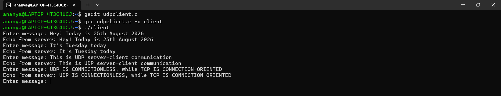

# Experiment 05: UDP Client Socket Programming

## 1. Experiment Title
Implementation of a Connectionless UDP Client Using Datagram Sockets in C.

---

## 2. Aim
To design, implement, and evaluate an interactive UDP client in C using POSIX datagram sockets (`SOCK_DGRAM`). The client transmits user-defined text messages to the UDP server listening on `127.0.0.1:10004` using `sendto()`, receives the echoed payload via `recvfrom()`, and displays the response on the terminal.

---

## 3. Theory / Introduction
In UDP communication, the client does not establish a persistent virtual circuit with the server. Instead, it directly encapsulates each data payload into an independent datagram with the destination IP address and port number embedded in the transport header.

### 3.1 UDP Client Socket Lifecycle

```
        socket()           --> Create datagram socket (AF_INET, SOCK_DGRAM)
           |
     +-----> fgets()       --> Read interactive message string from user input
     |         |
     |      sendto()      --> Transmits datagram to target Server (127.0.0.1:10004)
     |         |
     |      recvfrom()    --> Waits for and receives echoed datagram
     |         |
     |      printf()      --> Displays echoed message on console
     |         |
     +---------+           --> Continues until user terminates
           |
         close()           --> Releases socket descriptor
```

### 3.2 Contrast: TCP Client vs. UDP Client

| Architectural Feature | TCP Client (Exp 03) | UDP Client (Exp 05) |
|---|---|---|
| **Connection Setup** | Three-way handshake (`connect()` required) | None (`connect()` is optional) |
| **Transmission Call** | `send()` / `write()` | `sendto()` with destination address |
| **Reception Call** | `read()` / `recv()` | `recvfrom()` with address capture |
| **Data Boundary** | Continuous byte stream (no boundaries) | Preserved message/datagram boundaries |
| **State Tracking** | Connection state maintained by kernel | Stateless; each datagram is independent |
| **Server Offline Error** | `connect()` returns `Connection Failed` | `sendto()` succeeds (packet dropped silently by OS/network) |

---

## 4. Objectives
1. Understand the operational mechanics of connectionless UDP client communication.
2. Implement message framing and socket transmission using `sendto()`.
3. Receive echoed server packets using `recvfrom()` without a prior connection establishment.
4. Observe the lack of connection state and immediate datagram transmission.

---

## 5. Required Software and Tools
- **Operating System:** Linux (Ubuntu 20.04/22.04/24.04), WSL (Windows Subsystem for Linux), or any POSIX-compliant UNIX environment.
- **Compiler:** GCC (GNU Compiler Collection).
- **Text Editor / IDE:** Gedit, Nano, Vim, or Visual Studio Code.
- **Terminal:** Bash / GNOME Terminal / Windows Terminal.

---

## 6. Algorithm / Working Principle
1. Start the program.
2. Instantiate a UDP datagram socket using `socket(AF_INET, SOCK_DGRAM, 0)`.
3. If socket creation returns a negative value, display an error and terminate.
4. Set up the destination server address structure (`sockaddr_in server_addr`):
   - Set `sin_family = AF_INET`.
   - Set `sin_port = htons(PORT)` (`10004`).
   - Convert string IP address `"127.0.0.1"` into numeric format using `inet_addr()`.
5. Enter a `while (1)` loop:
   - Prompt the user: `"Enter message: "`.
   - Read input line into `buffer` using `fgets(buffer, BUF_SIZE, stdin)`. If EOF or error occurs, break loop.
   - Send the message datagram to the server using `sendto()`.
   - Clear the reception buffer with `memset()`.
   - Receive the echoed response datagram from the server using `recvfrom()`.
   - Null-terminate the received buffer.
   - Print the response: `"Echo from server: %s"`.
6. Close the socket using `close()`.
7. End the program.

---

## 7. Implementation Details
The client implementation is located in [udp_client.c](file:///C:/Users/Dipali/Downloads/cn%20lab/Computer-Networks-Lab/Experiment-05-UDP-Client/udp_client.c).

- **Target Server IP:** `127.0.0.1` (IPv4 Loopback)
- **Target Server Port:** `10004`
- **Buffer Size:** 1024 bytes
- **Socket Family:** AF_INET (IPv4)
- **Socket Type:** SOCK_DGRAM (UDP)

---

## 8. Source Code Explanation
- `sendto(sockfd, buffer, strlen(buffer), 0, (struct sockaddr *)&server_addr, sizeof(server_addr))`: Transmits the buffer content to the destination server specified in `server_addr`. The kernel assigns an ephemeral source port automatically upon the first transmission.
- `recvfrom(sockfd, buffer, BUF_SIZE, 0, NULL, NULL)`: Waits for an incoming datagram on the client's bound port. Since the client already knows the server's identity, passing `NULL` for the source address and length arguments simplifies the call.
- `fgets()`: Reads an entire line from standard input, preserving internal spaces and capturing the newline character.

---

## 9. Step-by-Step Execution Instructions

### Step 1: Start UDP Server First
Ensure the UDP server from **Experiment 04** is active:
```bash
# In Terminal 1:
cd Experiment-04-UDP-Server
gcc udp_server.c -o server
./server
```

### Step 2: Open Terminal for UDP Client
Open a second terminal window and navigate to the client directory:
```bash
# In Terminal 2:
cd Experiment-05-UDP-Client
```

### Step 3: Compile the Client Code
Compile using `gcc`:
```bash
gcc udp_client.c -o client
```

### Step 4: Run the UDP Client
Launch the client executable:
```bash
./client
```

### Step 5: Send Messages
Enter text at the `Enter message:` prompts. Observe the instantaneous echo reply returned by the server.

---

## 10. Sample Input
Interactive terminal inputs:
1. `Hey! Today is 25th August 2026`
2. `It's Tuesday today`
3. `This is UDP server-client communication`
4. `UDP IS CONNECTIONLESS, while TCP IS CONNECTION-ORIENTED`

---

## 11. Expected Output

```text
Enter message: Hey! Today is 25th August 2026
Echo from server: Hey! Today is 25th August 2026
Enter message: It's Tuesday today
Echo from server: It's Tuesday today
Enter message: This is UDP server-client communication
Echo from server: This is UDP server-client communication
Enter message: UDP IS CONNECTIONLESS, while TCP IS CONNECTION-ORIENTED
Echo from server: UDP IS CONNECTIONLESS, while TCP IS CONNECTION-ORIENTED
Enter message: 
```

### Screenshot Reference


---

## 12. Output Explanation
- `Enter message: ...`: User prompt awaiting string input from standard input.
- `Echo from server: ...`: Verifies that the client sent the message over UDP to port 10004, the server received it, read the client's ephemeral port, sent the exact string back, and the client unblocked from `recvfrom()` to display it.

---

## 13. Result / Conclusion
An interactive UDP client was successfully implemented in C using POSIX datagram sockets. The experiment demonstrated connectionless socket creation, packet encapsulation, datagram transmission using `sendto()`, and response reception using `recvfrom()`.

---

## 14. Important Viva Questions with Answers

### Q1: What happens if a UDP client sends data to a port where no server is running?
**Answer:** The `sendto()` system call will still succeed locally and return the number of bytes written to the kernel buffer. However, the destination host will typically respond with an ICMP "Port Unreachable" message. If the UDP socket is unconnected, this ICMP error is usually not delivered to the application.

### Q2: Can `connect()` be called on a UDP socket?
**Answer:** Yes. Calling `connect()` on a UDP socket does not perform a network handshake; instead, it associates the socket descriptor with a specific remote IP and port in the local kernel. This allows the program to use `send()` and `recv()` instead of `sendto()` and `recvfrom()`, and filters incoming packets to only those from the connected peer.

### Q3: Why is UDP preferred over TCP for real-time video streaming or online gaming?
**Answer:** Real-time applications prioritize low latency over 100% reliability. TCP's retransmission delays, head-of-line blocking, and congestion back-off mechanisms cause unacceptable jitter. In contrast, UDP sends data immediately without retransmissions, allowing frames with minor loss to be skipped in favor of real-time continuity.

### Q4: Does UDP provide flow control or congestion control?
**Answer:** No. UDP does not implement flow control (sliding window) or congestion control (AIMD/slow start). If a UDP sender transmits faster than the receiver can process or faster than intermediate routers can forward, buffers overflow and packets are dropped.

### Q5: What is the size of the UDP header, and what fields does it contain?
**Answer:** The UDP header is fixed at **8 bytes** (64 bits) and contains four 16-bit fields:
1. **Source Port** (16 bits)
2. **Destination Port** (16 bits)
3. **Length** (16 bits, header + payload length)
4. **Checksum** (16 bits, error detection)
