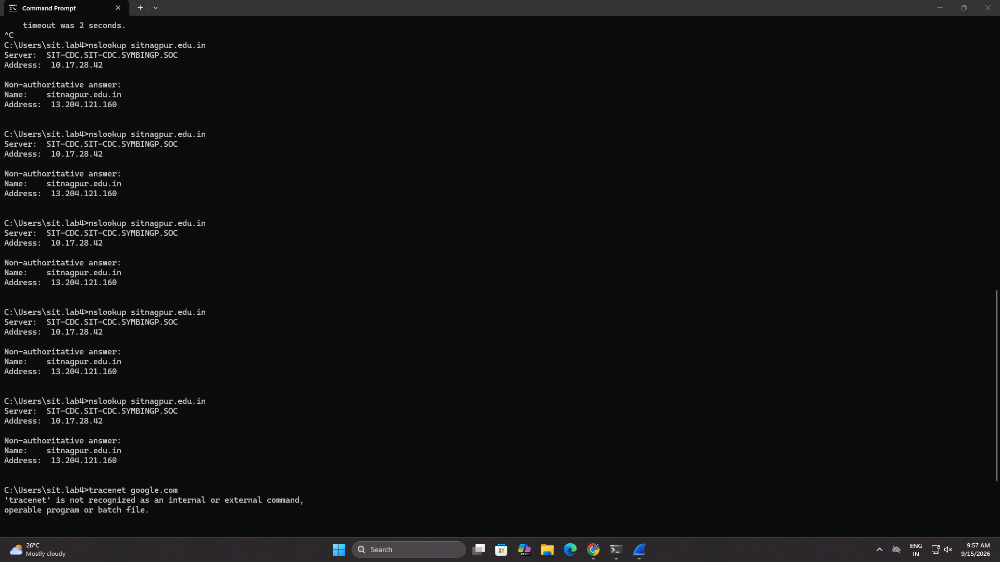
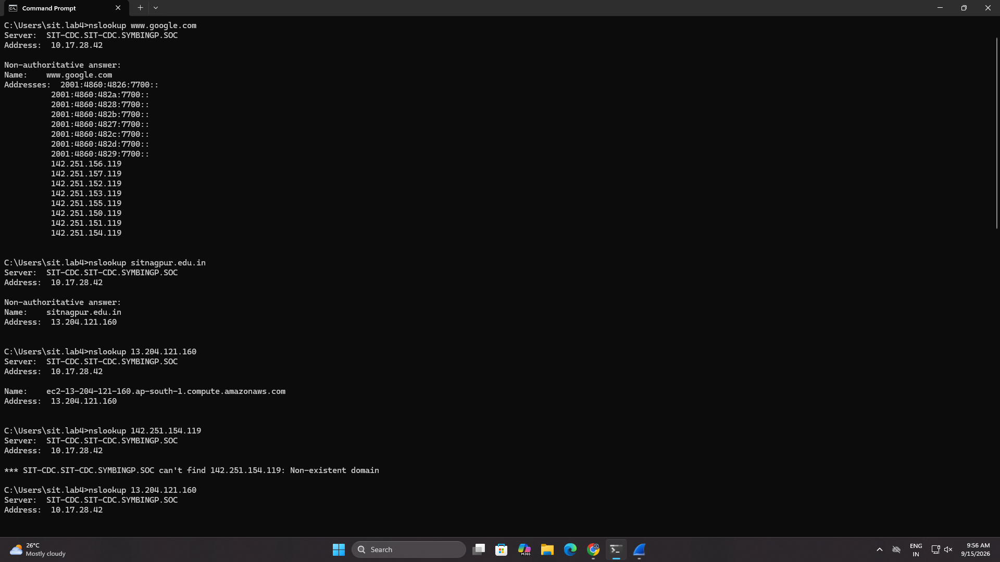
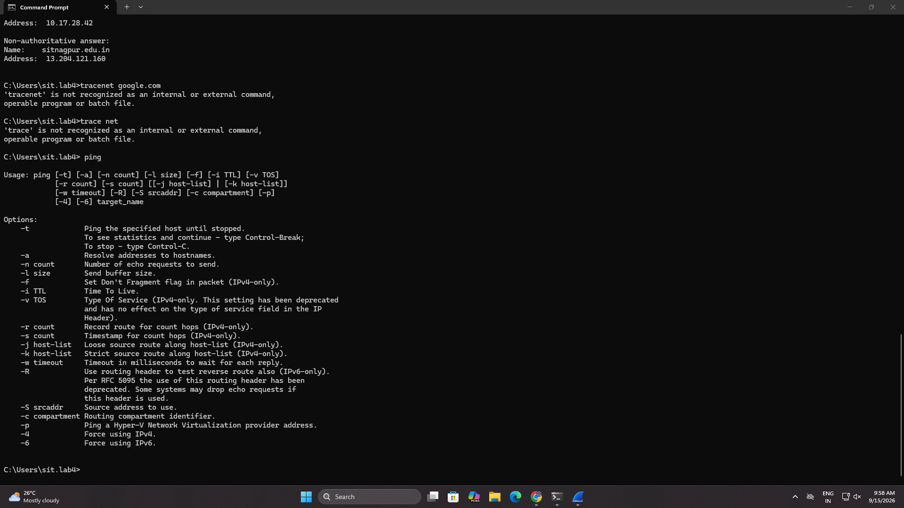

# Experiment 06: DNS Commands Using Terminal

## 1. Experiment Title
Demonstration and Analysis of DNS and Network Diagnostic Commands Using the Terminal.

---

## 2. Aim
To study the architecture of the Domain Name System (DNS) and execute terminal commands including `nslookup`, `ping`, `ipconfig`, and `tracert` on Windows/Linux environments. The practical covers forward DNS resolution, reverse DNS resolution (PTR), local DNS cache inspection, network interface configuration, and ICMP connectivity analysis.

---

## 3. Theory / Introduction
The Domain Name System (DNS) is a hierarchical, decentralized naming system that maps human-friendly Fully Qualified Domain Names (FQDNs), such as `www.google.com` or `sitnagpur.edu.in`, into machine-routable IP addresses (such as `142.251.156.119` or `13.204.121.160`).

### 3.1 DNS Hierarchy and Resolution Flow

```
                         [ Root DNS Servers (.) ]
                                     |
                       [ TLD DNS Servers (.edu / .com / .in) ]
                                     |
              [ Authoritative DNS Servers (sitnagpur.edu.in) ]
                                     ^
                                     | (Recursive Queries)
                            [ Local DNS Resolver ]
                              (e.g., 10.17.28.42)
                                     ^
                                     | (Query: sitnagpur.edu.in)
                               [ Client Host ]
```

### 3.2 DNS Record Types
- **A Record (Address):** Maps an FQDN to an IPv4 address (32-bit).
- **AAAA Record (IPv6 Address):** Maps an FQDN to an IPv6 address (128-bit).
- **CNAME (Canonical Name):** Creates an alias mapping one domain name to another domain name.
- **PTR (Pointer):** Resolves an IP address to a canonical hostname in reverse lookups (`in-addr.arpa`).
- **MX (Mail Exchanger):** Specifies mail servers responsible for accepting email for the domain.
- **NS (Name Server):** Delegates a DNS zone to use specific authoritative name servers.
- **SOA (Start of Authority):** Contains administrative information about the zone.

### 3.3 Core Network Diagnostic Commands

#### 1. `nslookup` (Name Server Lookup)
A cross-platform network administration command-line tool used for querying DNS servers to obtain domain name or IP address mappings.
- **Forward Lookup:** Queries for an IP address corresponding to a hostname.
- **Reverse Lookup:** Queries for a hostname associated with an IP address (using the PTR record).
- **Non-Authoritative Answer:** An answer returned by a caching or recursive server that does not hold the primary master zone file for the queried domain.

#### 2. `ping` (Packet Internet Groper)
Uses Internet Control Message Protocol (ICMP) **Echo Request (Type 8)** and **Echo Reply (Type 0)** packets to verify network-layer connectivity and measure round-trip time (RTT) and packet loss.
- In Windows: Defaults to sending 4 echo requests of 32 bytes each.
- Key switches:
  - `-t`: Pings the target host continuously until interrupted with `Ctrl + C`.
  - `-a`: Resolves IP address to hostname.
  - `-n count`: Number of echo requests to send.
  - `-l size`: Size of send buffer payload in bytes.
  - `-i TTL`: Sets Time to Live in the IP header.

#### 3. `ipconfig` (Windows) / `ip` or `ifconfig` (Linux)
Displays all current TCP/IP network configuration values, refreshes DHCP settings, and manages local DNS resolver cache:
- `ipconfig /all`: Displays full configuration (MAC address, IP, Subnet Mask, Default Gateway, DNS Servers, DHCP status).
- `ipconfig /flushdns`: Purges and resets the local DNS client resolver cache.
- `ipconfig /displaydns`: Displays contents of the local DNS client cache.

#### 4. `tracert` (Windows) / `traceroute` (Linux)
Traces the route packets take to reach a destination host by sending packets with incrementing Time To Live (TTL) values, inducing ICMP **Time Exceeded (Type 11)** responses from each intermediary router along the path.
*(Note: A common student error observed in lab environments is typing `tracenet` instead of `tracert`).*

---

## 4. Objectives
1. Perform forward and reverse DNS queries using `nslookup`.
2. Distinguish between authoritative and non-authoritative DNS responses.
3. Inspect network adapter parameters and local DNS resolver configurations.
4. Test network latency, reachability, and packet fragmentation thresholds using `ping`.

---

## 5. Required Software and Tools
- **Operating System:** Windows 10/11 Command Prompt / PowerShell or Linux Terminal.
- **Tools:** Built-in command-line networking utilities (`nslookup`, `ping`, `ipconfig`, `tracert`).

---

## 6. Command Execution and Practical Reference

### 6.1 Forward DNS Lookup for University Domain
Querying the IP address of `sitnagpur.edu.in`:
```cmd
nslookup sitnagpur.edu.in
```

#### Observed Output:
```text
Server:  SIT-CDC.SIT-CDC.SYMBINGP.SOC
Address:  10.17.28.42

Non-authoritative answer:
Name:    sitnagpur.edu.in
Address:  13.204.121.160
```


### 6.2 Forward DNS Lookup for High-Availability Domain (Multiple A & AAAA Records)
Querying `www.google.com`:
```cmd
nslookup www.google.com
```

#### Observed Output:
```text
Server:  SIT-CDC.SIT-CDC.SYMBINGP.SOC
Address:  10.17.28.42

Non-authoritative answer:
Name:    www.google.com
Addresses:  2001:4860:4826:7700::
          2001:4860:482a:7700::
          2001:4860:4828:7700::
          2001:4860:482b:7700::
          2001:4860:4827:7700::
          2001:4860:482c:7700::
          2001:4860:482d:7700::
          2001:4860:4829:7700::
          142.251.156.119
          142.251.157.119
          142.251.152.119
          142.251.153.119
          142.251.155.119
          142.251.150.119
          142.251.151.119
          142.251.154.119
```


### 6.3 Reverse DNS Lookup (PTR Query)
Resolving an IP address back to its fully qualified domain name:
```cmd
nslookup 13.204.121.160
```

#### Observed Output:
```text
Server:  SIT-CDC.SIT-CDC.SYMBINGP.SOC
Address:  10.17.28.42

Name:    ec2-13-204-121-160.ap-south-1.compute.amazonaws.com
Address:  13.204.121.160
```

*When querying an IP without a PTR record (e.g. `142.251.154.119`), the DNS server returns:*
```text
*** SIT-CDC.SIT-CDC.SYMBINGP.SOC can't find 142.251.154.119: Non-existent domain
```

### 6.4 Ping Command and Usage Syntax
Displaying `ping` options in Windows Command Prompt:
```cmd
ping
```

#### Observed Output:
```text
Usage: ping [-t] [-a] [-n count] [-l size] [-f] [-i TTL] [-v TOS]
            [-r count] [-s count] [[-j host-list] | [-k host-list]]
            [-w timeout] [-R] [-S srcaddr] [-c compartment] [-p]
            [-4] [-6] target_name

Options:
    -t             Ping the specified host until stopped.
                   To see statistics and continue - type Control-Break;
                   To stop - type Control-C.
    -a             Resolve addresses to hostnames.
    -n count       Number of echo requests to send.
    -l size        Send buffer size.
    -f             Set Don't Fragment flag in packet (IPv4-only).
    -i TTL         Time To Live.
    -v TOS         Type Of Service (IPv4-only).
    -w timeout     Timeout in milliseconds to wait for each reply.
    -4             Force using IPv4.
    -6             Force using IPv6.
```


### 6.5 Diagnostic Troubleshooting: Command Name Discrepancies
In laboratory sessions, attempting to run `tracenet` results in:
```text
'tracenet' is not recognized as an internal or external command,
operable program or batch file.
```
- **Correction:** The correct Windows route tracing utility is **`tracert`** (e.g., `tracert google.com`). In Linux/macOS, the equivalent command is **`traceroute`**.

---

## 7. Output Explanation
1. **Server (`10.17.28.42`):** The local enterprise recursive caching DNS server that answered the query on behalf of the client workstation.
2. **Non-authoritative answer:** Confirms that the local DNS server (`10.17.28.42`) fetched the record from another authoritative server or served it directly from its RAM cache.
3. **Reverse Lookup Result (`ec2-13-204-121-160.ap-south-1.compute.amazonaws.com`):** Identifies that the server hosting `sitnagpur.edu.in` is provisioned on Amazon Web Services (AWS) EC2 in the `ap-south-1` (Mumbai) region.
4. **Multiple IP Addresses:** Returned for `www.google.com` to achieve DNS round-robin load balancing and geographic distribution across Google's edge cache clusters.

---

## 8. Result / Conclusion
DNS resolution and fundamental network troubleshooting utilities (`nslookup`, `ping`, `ipconfig`, `tracert`) were demonstrated. The principles of forward DNS resolution, PTR reverse lookups, IPv4/IPv6 dual-stack addressing, and ICMP connectivity analysis were verified.

---

## 9. Important Viva Questions with Answers

### Q1: What is the difference between an authoritative and a non-authoritative DNS response?
**Answer:** An **authoritative response** originates directly from a name server configured with the primary or secondary master zone file for that domain. A **non-authoritative response** comes from a recursive resolver or third-party DNS server that answered the query using cached data or by querying another name server.

### Q2: What is a reverse DNS lookup, and which record type does it utilize?
**Answer:** A reverse DNS lookup translates an IP address back to its associated hostname. It uses **PTR (Pointer)** records located in the special reverse lookup domains `in-addr.arpa` (for IPv4) and `ip6.arpa` (for IPv6).

### Q3: What is the significance of the `ipconfig /flushdns` command?
**Answer:** It purges the local operating system DNS resolver cache stored in memory. This is essential when a domain's IP mapping has changed, but the local machine continues attempting to connect to an outdated, cached IP address.

### Q4: How does `tracert` determine intermediate router hops?
**Answer:** `tracert` sends a sequence of packets with increasing Time To Live (TTL) values, starting at `TTL = 1`. The first router decrements the TTL to 0, drops the packet, and returns an ICMP **Time Exceeded (Type 11, Code 0)** message to the sender, revealing its IP address. This continues incrementing until the destination responds.

### Q5: What is the default transport protocol and port used by DNS?
**Answer:** DNS primarily uses **UDP port 53** for standard queries and responses due to its low overhead and latency. However, it falls back to **TCP port 53** for zone transfers (AXFR) or when response payloads exceed 512 bytes (without EDNS0).
