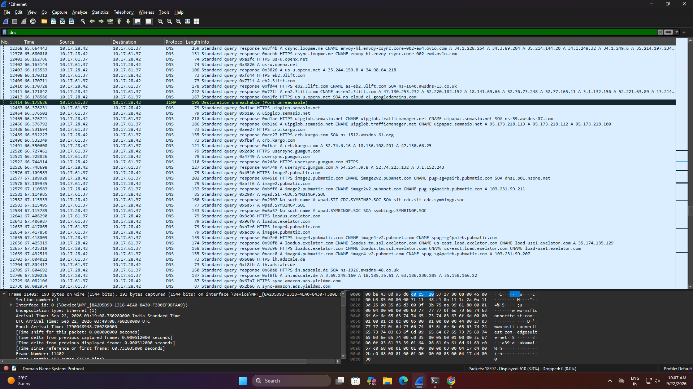
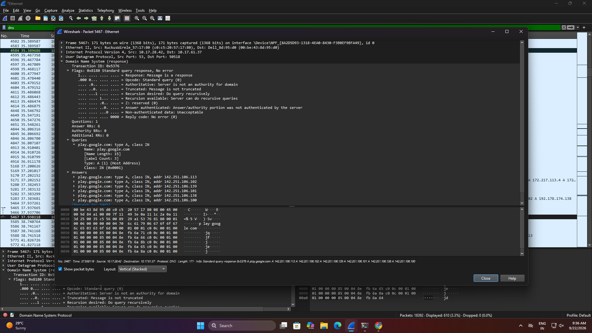
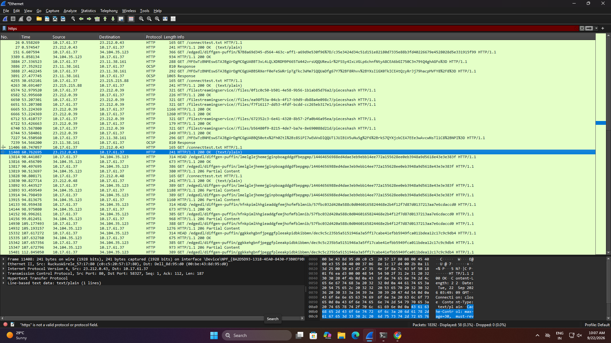
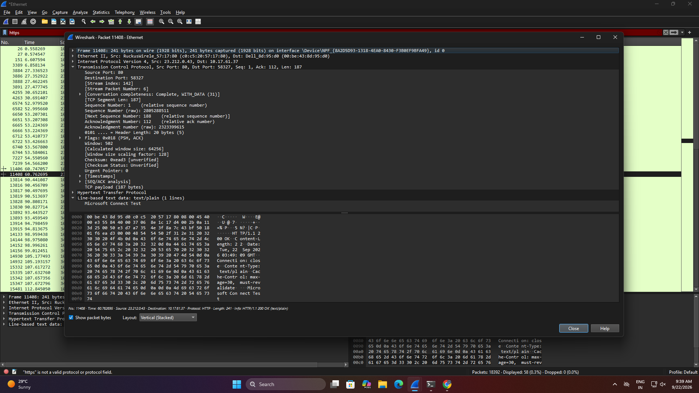

# Experiment 07: DNS and HTTPS Packet Analysis Using Wireshark

## 1. Experiment Title
Packet Sniffing and Protocol Analysis of DNS and HTTP/HTTPS (TLS) Traffic Using Wireshark.

---

## 2. Aim
To capture live network packets using the Wireshark network protocol analyzer, apply specific display filters, inspect protocol headers layer-by-layer across the OSI/TCP-IP stack, analyze the structure of DNS query and response transactions, and evaluate the security distinctions between plaintext HTTP and encrypted HTTPS (TLS) traffic.

---

## 3. Theory / Introduction
Wireshark is an open-source packet analyzer that captures network frames directly from a Network Interface Card (NIC) via the Npcap (Windows) or libpcap (Linux) library. It decodes raw hexadecimal bitstreams into human-readable protocol hierarchies.

### 3.1 Encapsulation Hierarchy (OSI Stack Representation)

```
 +-------------------------------------------------------------------------+
 | Layer 2: Data Link | Ethernet II (Source MAC -> Destination MAC)         |
 +--------------------+----------------------------------------------------+
 | Layer 3: Network   | IPv4 (Source IP -> Destination IP, Protocol: UDP/TCP) |
 +--------------------+----------------------------------------------------+
 | Layer 4: Transport | UDP (Port 53 for DNS) OR TCP (Port 80/443)         |
 +--------------------+----------------------------------------------------+
 | Layer 7: App Layer | DNS / HTTP / TLS (Encrypted Application Data)      |
 +-------------------------------------------------------------------------+
```

### 3.2 DNS Packet Architecture
DNS messages are exchanged over UDP port `53`. The packet format contains:
- **Transaction ID (16 bits):** A random identifier assigned by the client to correlate query and response packets.
- **Flags (16 bits):**
  - `QR (Query/Response)`: 0 = Query, 1 = Response.
  - `Opcode`: 0 = Standard Query.
  - `AA (Authoritative Answer)`: Indicates if the responding server is authoritative.
  - `TC (Truncated)`: Indicates if message exceeds 512 bytes.
  - `RD (Recursion Desired)`: Set by client requesting recursive resolution.
  - `RA (Recursion Available)`: Set by server indicating recursive queries are supported.
  - `RCODE (Reply Code)`: 0 = No Error, 3 = Non-Existent Domain (NXDomain).
- **Questions:** Count and list of domain queries (Name, Type, Class).
- **Answers:** Count and resource records (Name, Type, TTL, IP Address).

```
 +------------------------------------------------------------------+
 |                       DNS Header Structure                       |
 +--------------------------------+---------------------------------+
 |      Transaction ID (16)       |          Flags (16)             |
 +--------------------------------+---------------------------------+
 |      Questions Count (16)      |        Answer RRs Count (16)    |
 +--------------------------------+---------------------------------+
 |     Authority RRs Count (16)   |      Additional RRs Count (16)  |
 +--------------------------------+---------------------------------+
 |                   Queries / Answers Payload                      |
 +------------------------------------------------------------------+
```

### 3.3 HTTP vs. HTTPS / TLS Analysis
- **HTTP (Hypertext Transfer Protocol - TCP Port 80):** Transmits data entirely in unencrypted plaintext. Headers (`GET /connecttest.txt HTTP/1.1`), status codes (`HTTP/1.1 200 OK`), and message payloads (`Microsoft Connect Test`) are visible in clear text.
- **HTTPS (HTTP Secure - TCP Port 443):** Wraps HTTP inside a Transport Layer Security (TLS) tunnel. The client and server perform a cryptographic handshake to authenticate the server (via X.509 certificates) and negotiate symmetric encryption keys (AES-GCM / ChaCha20-Poly1305). Once the handshake completes, all application data is encrypted.
- **Wireshark Display Filter Syntax:**
  - Filtering by `http` captures unencrypted web traffic on port 80.
  - Typing `https` directly into the Wireshark filter bar produces a **syntax error** (`""https" is not a valid protocol or protocol field"`). In Wireshark, encrypted secure traffic is filtered using **`tls`**, **`ssl`**, or **`tcp.port == 443`**.
  - **Important Reality:** Without importing the client's ephemeral symmetric session keys (`SSLKEYLOGFILE`), Wireshark cannot decrypt TLS Application Data.

---

## 4. Objectives
1. Capture real-time packet streams on an active Ethernet/Wi-Fi interface.
2. Filter and inspect DNS query/response structures, noting Transaction ID and Flags.
3. Identify the four protocol layers encapsulated inside an Ethernet frame.
4. Compare plaintext HTTP payload inspection against encrypted TLS sessions.
5. Understand Wireshark filter syntax and common configuration mistakes.

---

## 5. Required Software and Tools
- **Software:** Wireshark (v4.x or higher) with Npcap/WinPcap packet capture driver.
- **Command-line Utilities:** `nslookup`, web browser (Chrome, Edge, Firefox), or `curl`.

---

## 6. Step-by-Step Practical Procedure

### Step 1: Launch Wireshark and Select Interface
1. Open Wireshark with administrative privileges.
2. Double-click the active network adapter (e.g., `Ethernet` or `Wi-Fi`) displaying live packet activity.

### Step 2: Capture and Analyze DNS Packets
1. In the display filter bar, type `dns` and press `Enter`.
2. Open a command prompt and trigger a DNS query:
   ```cmd
   nslookup play.google.com
   ```
3. Stop packet capture (`Ctrl + E`).
4. Locate the captured DNS response packet in the packet list pane.

#### Observed DNS Stream:


#### Detailed Inspection of DNS Response (Packet #5467):


#### Packet Layer Breakdown from Capture:
- **Frame 5467:** 171 bytes on wire (1368 bits).
- **Ethernet II:**
  - Source MAC: `c0:c5:20:57:17:80` (Gateway / Router)
  - Destination MAC: `00:be:43:8d:95:d0` (Workstation NIC)
  - Type: IPv4 (`0x0800`)
- **Internet Protocol Version 4:**
  - Source IP: `10.17.28.42` (DNS Server)
  - Destination IP: `10.17.61.37` (Local Host)
  - Protocol: UDP (`17`)
- **User Datagram Protocol:**
  - Source Port: `53` (Standard DNS port)
  - Destination Port: `50518` (Ephemeral client port)
- **Domain Name System (response):**
  - Transaction ID: `0x5376`
  - Flags: `0x8180` Standard query response, No error
    - Response: `1` (Message is a response)
    - Opcode: `0` (Standard query)
    - Authoritative: `0` (Server is not an authority for domain)
    - Truncated: `0` (Message is not truncated)
    - Recursion desired: `1`
    - Recursion available: `1`
  - Questions: `1` (`play.google.com: type A, class IN`)
  - Answers: `6` (Returns IPv4 addresses including `142.251.106.113`, `142.251.106.102`, etc.)

---

### Step 3: Capture and Analyze HTTP vs HTTPS (TLS) Traffic
1. In Wireshark, begin a new capture.
2. In the filter bar, observe what happens when typing `https`:
   - The filter background turns **red**, with status: `""https" is not a valid protocol or protocol field."`.
   - The correct display filter is **`http`** for unencrypted web traffic, or **`tls`** / **`tcp.port == 443`** for HTTPS.
3. Apply filter `http` and observe plaintext packets (e.g. `connecttest.txt` generated by OS network detection).

#### Observed HTTP Filter Error & Traffic:


#### Detailed Inspection of Plaintext HTTP Packet (#11408):


#### Packet Layer Breakdown from HTTP Capture:
- **Frame 11408:** 241 bytes on wire.
- **Ethernet II:** Src MAC `c0:c5:20:57:17:80` $\rightarrow$ Dst MAC `00:be:43:8d:95:d0`.
- **IPv4:** Src IP `23.212.0.43` (Microsoft Akamai CDN) $\rightarrow$ Dst IP `10.17.61.37`.
- **Transmission Control Protocol:**
  - Source Port: `80` (HTTP)
  - Destination Port: `58327` (Client ephemeral port)
  - Flags: `0x018` (`[PSH, ACK]`)
- **Hypertext Transfer Protocol:**
  - Status Line: `HTTP/1.1 200 OK`
  - Content-Type: `text/plain`
- **Line-based text data:**
  - Raw payload: `Microsoft Connect Test` *(completely readable in plain text)*

---

## 7. Comparative Analysis: HTTP vs HTTPS (TLS)

| Parameter | HTTP (Frame #11408) | HTTPS / TLS (TCP Port 443) |
|---|---|---|
| **Port** | Port 80 | Port 443 |
| **Wireshark Filter** | `http` | `tls` or `tcp.port == 443` (`https` is invalid) |
| **Confidentiality** | None; payload displayed in plaintext (`Microsoft Connect Test`) | Fully encrypted using symmetric cipher (AES/ChaCha20) |
| **Integrity** | Vulnerable to tampering / man-in-the-middle injection | Cryptographic HMAC / AEAD tags prevent modification |
| **Authentication** | None | Server identity authenticated via digital X.509 certificate |
| **Wireshark Visibility** | Headers, URLs, queries, and payload fully readable | Only TLS handshake metadata (SNI, Cipher suites) visible; payload is opaque |

---

## 8. Result / Conclusion
Live network traffic was successfully captured and analyzed using Wireshark. The dissection confirmed the hierarchical encapsulation of Ethernet, IPv4, UDP, and TCP protocols. DNS query and response formats were verified via transaction IDs and status flags. The clear-text vulnerability of HTTP was demonstrated and contrasted with the encryption safeguards provided by HTTPS/TLS.

---

## 9. Important Viva Questions with Answers

### Q1: Why is typing `https` into Wireshark's display filter bar invalid?
**Answer:** Wireshark organizes filters based on recognized protocol dissectors. "HTTPS" is not a standalone protocol dissector in Wireshark; rather, HTTPS represents HTTP transported over the **TLS (Transport Layer Security)** or **SSL** protocol. Therefore, the valid display filters are `tls`, `ssl`, or `tcp.port == 443`.

### Q2: Can Wireshark decrypt HTTPS application data without private keys?
**Answer:** No. Modern HTTPS connections use Ephemeral Diffie-Hellman key exchanges (DHE/ECDHE) to achieve **Perfect Forward Secrecy (PFS)**. Each session generates unique temporary session keys. Even possession of the server's long-term RSA private key cannot decrypt past traffic unless the client's dynamic pre-master secret is logged (e.g. via the `SSLKEYLOGFILE` environment variable).

### Q3: What is the purpose of the Transaction ID in a DNS packet?
**Answer:** Because DNS uses the connectionless UDP protocol, there is no persistent socket connection. The 16-bit Transaction ID enables the client's DNS resolver to match each asynchronous incoming response from the DNS server with the corresponding query it sent.

### Q4: What information is visible in the clear during a TLS handshake?
**Answer:** During the initial unencrypted TLS handshake, observers can inspect:
1. **Client Hello:** Supported cipher suites, TLS version, and the **Server Name Indication (SNI)** extension (revealing the domain name being contacted).
2. **Server Hello:** Chosen cipher suite and TLS version.
3. **Certificate:** The server's public digital certificate containing its public key, issuer CA, and domain validity.

### Q5: What does the `0x8180` DNS flag field signify?
**Answer:** In hexadecimal, `0x8180` represents binary `1000 0001 1000 0000`:
- Bit 0 (`QR = 1`): Packet is a Response.
- Bits 1–4 (`Opcode = 0`): Standard Query.
- Bit 5 (`AA = 0`): Non-Authoritative Answer.
- Bit 6 (`TC = 0`): Not Truncated.
- Bit 7 (`RD = 1`): Recursion was Desired.
- Bit 8 (`RA = 1`): Recursion is Available on the server.
- Bits 12–15 (`RCODE = 0`): No Error.
