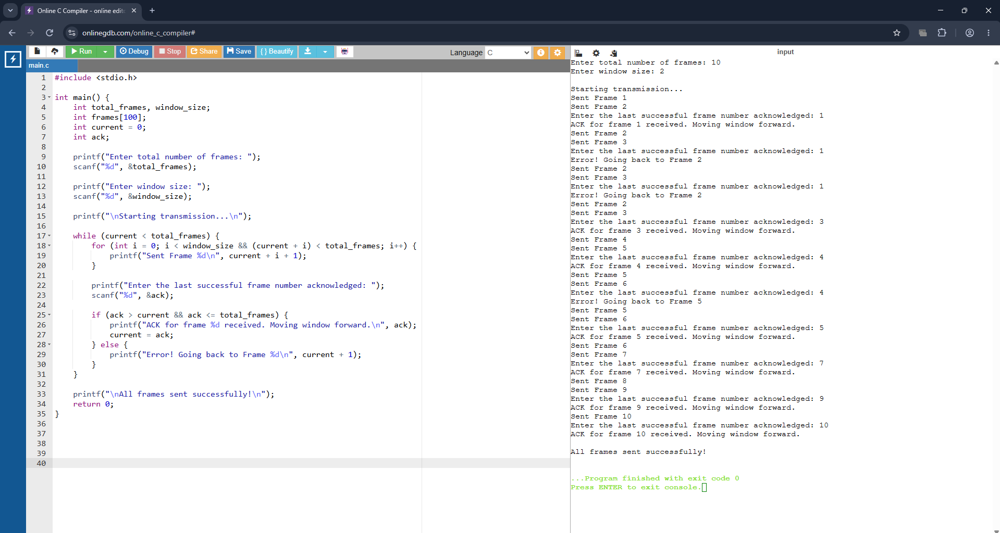

# Experiment 08: Sliding Window Protocol

## 1. Experiment Title
Simulation of the Sliding Window Flow Control Protocol in C.

---

## 2. Aim
To design, implement, and simulate the Sliding Window (Go-Back-N) protocol in C. The program simulates sender window management, frame transmission within the permissible window size, cumulative acknowledgment reception, window advancement upon successful ACKs, and window rollback (retransmission) upon transmission errors.

---

## 3. Theory / Introduction
In computer networks, flow control prevents a fast sender from overwhelming a slow receiver with data. Unrestricted transmission on unreliable physical links leads to buffer overflows, packet loss, and severe network degradation.

### 3.1 Flow Control Protocols
- **Stop-and-Wait ARQ:** The sender transmits one frame and waits for an acknowledgment (ACK) before transmitting the next. Under high propagation delay (high bandwidth-delay product links), channel utilization is extremely low.
- **Sliding Window Protocols:** Allow the sender to transmit multiple consecutive frames before waiting for an ACK (pipelining). The maximum number of unacknowledged frames in transit is bounded by the **Window Size ($N$)**.

### 3.2 Sliding Window Working Mechanism (Go-Back-N Principle)

```
 Frame Sequence:   1   2   3   4   5   6   7   8   9   10
                 +-------+
 Initial Window: | 1   2 |  (Window Size = 2)
                 +-------+
                  --> Send Frame 1, Frame 2
                  <-- Receive ACK for Frame 1
                     +-------+
  Window Slides:     | 2   3 |
                     +-------+
                  --> Send Frame 2, Frame 3
                  <-- Error on Frame 2 ACK
                     (Window rolls back: Retransmit Frame 2)
```

1. **Sender Window ($W_s$):** Defines the range of consecutive sequence numbers the sender is permitted to transmit without receiving an ACK.
2. **Window Sliding:** When the sender receives an acknowledgment for frame $k$ such that $k > \text{current}$, the base of the window slides forward to $k$, allowing new frames to be transmitted.
3. **Error Handling (Go-Back-N):** If an acknowledgment fails or reports an unacknowledged frame, the sender retreats to the earliest unacknowledged frame (`current + 1`) and retransmits all frames within the current window.

---

## 4. Objectives
1. Understand the concept of pipelined data transmission and link utilization.
2. Implement dynamic window boundaries (`current` to `current + window_size`).
3. Model positive acknowledgment reception and window advancement.
4. Simulate retransmission upon corrupted or lost acknowledgments.

---

## 5. Required Software and Tools
- **Language:** C (Standard C99 or C11).
- **Compiler:** GCC (GNU Compiler Collection) or Clang.
- **Platforms:** Linux, WSL, macOS, Windows (GCC/MinGW), or Online C Compilers (e.g., OnlineGDB).

---

## 6. Algorithm / Working Principle
1. Start the program.
2. Read the total number of frames (`total_frames`) to transmit.
3. Read the sender window size (`window_size`).
4. Initialize `current = 0` (representing the base of unacknowledged frames).
5. While `current < total_frames`:
   - Transmit (print) all frames within the current window from `i = 0` up to `window_size - 1`, provided `(current + i) < total_frames`.
   - Prompt the user to enter the last successful frame number acknowledged (`ack`).
   - If `ack > current` and `ack <= total_frames`:
     - Print confirmation: `"ACK for frame %d received. Moving window forward."`.
     - Advance window base: `current = ack`.
   - Else:
     - Print error: `"Error! Going back to Frame %d"`, referencing `current + 1`.
     - The window does not slide; transmission repeats from `current + 1`.
6. When `current >= total_frames`, print: `"\nAll frames sent successfully!"`.
7. End the program.

---

## 7. Implementation Details
The simulation code is located in [sliding_window.c](file:///C:/Users/Dipali/Downloads/cn%20lab/Computer-Networks-Lab/Experiment-08-Sliding-Window/sliding_window.c).

- **Data Structures:** Primitive integer counters tracking window limits and frame sequence indices.
- **Execution Model:** Interactive console simulation allowing the user to inject simulated ACK values or errors.

---

## 8. Source Code Explanation
- `for (int i = 0; i < window_size && (current + i) < total_frames; i++)`: Iterates through the permissible window slice, ensuring transmission never overflows past `total_frames`.
- `if (ack > current && ack <= total_frames)`: Validates that the received acknowledgment represents forward progress. If valid, `current` is updated directly to `ack` (cumulative acknowledgment).
- `printf("Error! Going back to Frame %d\n", current + 1)`: Implements Go-Back-N error recovery by restarting transmission from the first unacknowledged frame.

---

## 9. Step-by-Step Execution Instructions

### Step 1: Open Terminal
Navigate to the experiment directory:
```bash
cd Experiment-08-Sliding-Window
```

### Step 2: Compile the Code
Compile with `gcc`:
```bash
gcc sliding_window.c -o sliding_window
```

### Step 3: Run the Program
Launch the executable:
```bash
./sliding_window
```

---

## 10. Sample Input
- Total number of frames: `10`
- Window size: `2`
- Sequence of acknowledged frame inputs entered by user:
  `1`, `1` (simulated failure), `1` (simulated failure), `3`, `4`, `4` (simulated failure), `5`, `7`, `9`, `10`.

---

## 11. Expected Output

```text
Enter total number of frames: 10
Enter window size: 2

Starting transmission...
Sent Frame 1
Sent Frame 2
Enter the last successful frame number acknowledged: 1
ACK for frame 1 received. Moving window forward.
Sent Frame 2
Sent Frame 3
Enter the last successful frame number acknowledged: 1
Error! Going back to Frame 2
Sent Frame 2
Sent Frame 3
Enter the last successful frame number acknowledged: 1
Error! Going back to Frame 2
Sent Frame 2
Sent Frame 3
Enter the last successful frame number acknowledged: 3
ACK for frame 3 received. Moving window forward.
Sent Frame 4
Sent Frame 5
Enter the last successful frame number acknowledged: 4
ACK for frame 4 received. Moving window forward.
Sent Frame 5
Sent Frame 6
Enter the last successful frame number acknowledged: 4
Error! Going back to Frame 5
Sent Frame 5
Sent Frame 6
Enter the last successful frame number acknowledged: 5
ACK for frame 5 received. Moving window forward.
Sent Frame 6
Sent Frame 7
Enter the last successful frame number acknowledged: 7
ACK for frame 7 received. Moving window forward.
Sent Frame 8
Sent Frame 9
Enter the last successful frame number acknowledged: 9
ACK for frame 9 received. Moving window forward.
Sent Frame 10
Enter the last successful frame number acknowledged: 10
ACK for frame 10 received. Moving window forward.

All frames sent successfully!
```

### Screenshot Reference


---

## 12. Output Explanation
- When `ack = 1` is entered after sending frames 1 and 2, frame 1 is confirmed and the window shifts forward to cover frames 2 and 3.
- When an outdated `ack = 1` is entered again, the check `ack > current` fails. The program prints `Error! Going back to Frame 2` and retransmits frames 2 and 3.
- When `ack = 3` is entered, frames 2 and 3 are acknowledged simultaneously (cumulative ACK), advancing the window to frames 4 and 5.
- The transmission loop terminates when all 10 frames are positively acknowledged.

---

## 13. Result / Conclusion
The Sliding Window protocol was simulated in C. The experiment demonstrated pipelined transmission of multiple frames within the specified window, cumulative acknowledgment processing, window sliding, and retransmission recovery upon simulated channel errors.

---

## 14. Important Viva Questions with Answers

### Q1: What is the primary difference between Go-Back-N ARQ and Selective Repeat ARQ?
**Answer:** In **Go-Back-N ARQ**, the receiver only accepts frames in strict sequential order and discards out-of-order frames; if a frame is lost, the sender retransmits the lost frame and all subsequent frames in the current window. In **Selective Repeat ARQ**, the receiver buffers out-of-order frames, and the sender retransmits **only** the specific frame that was lost or corrupted.

### Q2: What is the maximum sender window size in Go-Back-N given $m$ sequence bits?
**Answer:** For an $m$-bit sequence number field, the maximum sender window size in Go-Back-N is **$2^m - 1$**. If the window size were $2^m$, the receiver would be unable to distinguish between a new frame and a retransmission of an old frame if all ACKs were lost.

### Q3: What is the maximum window size in Selective Repeat?
**Answer:** In Selective Repeat ARQ, both sender and receiver window sizes must be at most **$2^{m-1}$** (half of the sequence space) to avoid overlap between new and retransmitted frame sequence numbers.

### Q4: How does sliding window improve channel efficiency compared to Stop-and-Wait?
**Answer:** In Stop-and-Wait, efficiency is $\eta = \frac{T_t}{T_t + 2 T_p}$. In Sliding Window with window size $N$, efficiency becomes $\eta = \min\left(1, \frac{N \times T_t}{T_t + 2 T_p}\right)$. By keeping the pipeline full during the Round Trip Time ($2 T_p$), idle channel waiting time is eliminated.

### Q5: What is piggybacking in sliding window protocols?
**Answer:** Piggybacking is an optimization technique where outgoing acknowledgments are temporarily delayed so they can be attached to an outgoing data frame traveling in the reverse direction, reducing protocol header overhead.
