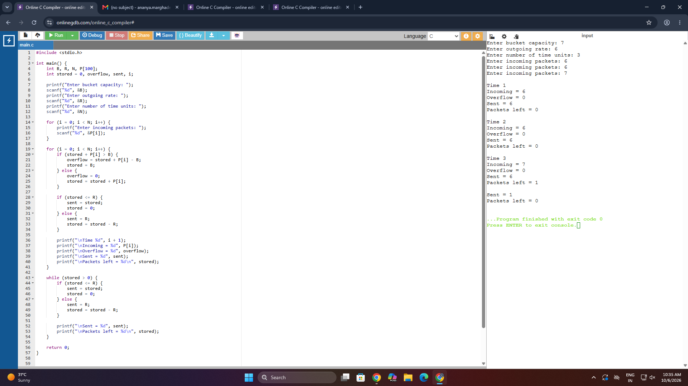
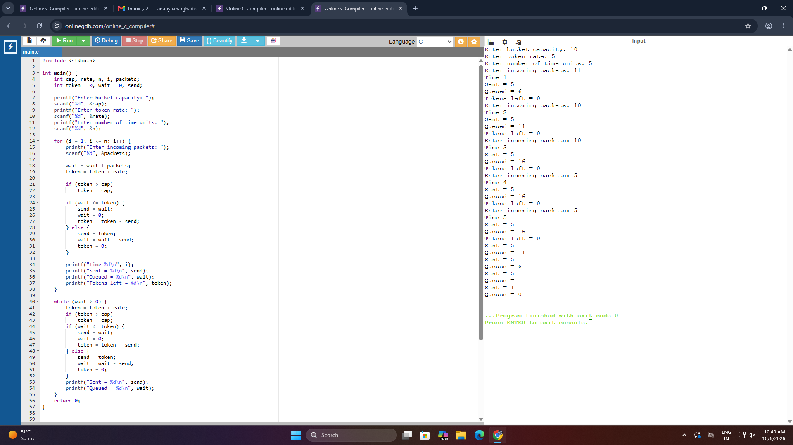

# Experiment 09: Traffic Shaping Algorithms

## 1. Experiment Title
Implementation of Traffic Shaping Algorithms (Leaky Bucket and Token Bucket) in C.

---

## 2. Aim
To design, implement, and analyze open-loop congestion control traffic shaping mechanisms in C. The experiment implements:
1. **The Leaky Bucket Algorithm:** To enforce a rigid, constant data output rate regardless of incoming burstiness, dropping packets that exceed buffer capacity.
2. **The Token Bucket Algorithm:** To allow controlled bursty transmissions up to a defined token capacity while regulating the long-term average transmission rate.

---

## 3. Theory / Introduction
Network traffic is inherently bursty—applications transmit large chunks of data intermittently followed by idle intervals. If multiple hosts inject bursty traffic simultaneously, intermediate switches and routers experience buffer exhaustion, leading to packet drops, increased jitter, and network congestion.

**Traffic shaping** regulates the rate and volume of data packets transmitted onto a network, converting irregular, bursty traffic into a predictable, smooth stream.

### 3.1 The Leaky Bucket Algorithm
The Leaky Bucket algorithm models a bucket with a small hole in the bottom:
- Incoming packets arrive at arbitrary, bursty intervals and enter a finite queue (the bucket of capacity $B$).
- If incoming packets cause the queue to exceed capacity $B$, the excess packets **overflow and are discarded**.
- Packets are transmitted out of the bucket at a **constant, rigid rate ($R$)** per time unit, regardless of arrival bursts.

```
       Bursty Incoming Traffic (Variable Rate)
                   |  |  |  |
                   v  v  v  v
             +-----------------+
             | \             / |  <-- Bucket Capacity (B)
             |  \           /  |      (Excess packets discarded on overflow)
             |   \         /   |
             +-----\     /-----+
                    |   |
                    |   |      <-- Constant Outgoing Rate (R)
                    v   v
        Smooth, Uniform Outgoing Stream
```

### 3.2 The Token Bucket Algorithm
The Token Bucket algorithm decouples packet queuing from rate regulation:
- Tokens are generated periodically by a clock at a constant rate ($r$ tokens/second) and stored in a token bucket of maximum capacity ($C$).
- If the token bucket is full, newly generated tokens are discarded (no packet data is lost).
- To transmit a packet of length $m$, the sender must remove $m$ tokens from the bucket.
- If sufficient tokens are available, the packet is transmitted immediately. If tokens are insufficient, packets are queued in a wait buffer until tokens accumulate.
- **Advantage:** Enables controlled burst transmissions up to bucket capacity while maintaining a strict upper limit on the long-term average rate.

```
      Tokens Generated at Rate (r)
                 |
                 v
        +-----------------+
        |  Token Bucket   |  <-- Max Token Capacity (C)
        +-----------------+
                 |
       (Tokens Deducted)
                 v
   +---------------------------+
   | Incoming Packets -> Transmit if Tokens Available -> Network Link
   +---------------------------+ (Bursts allowed up to Capacity C)
```

---

## 4. Comparison: Leaky Bucket vs. Token Bucket

| Feature | Leaky Bucket | Token Bucket |
|---|---|---|
| **Outgoing Rate** | Strictly constant and uniform | Bursty up to token bucket capacity; average rate bounded |
| **Burst Handling** | Smooths out bursts entirely; drops excess immediately | Accommodates short bursts without packet discard |
| **Discard Behavior** | Discards packets when the packet buffer overflows | Discards *tokens* when full; packets wait in buffer |
| **Storage Element** | Stores packets directly in a buffer queue | Stores *tokens* representing transmission permits |
| **Use Case** | ATM networks, CBR (Constant Bit Rate) audio/video | Internet IP networks, variable bit rate (VBR) video, QoS policing |

---

## 5. Objectives
1. Implement the queueing and rate-limiting logic of the Leaky Bucket algorithm.
2. Implement the token accumulation, quota deduction, and queuing mechanics of the Token Bucket algorithm.
3. Compare throughput, packet drop behavior, and queue latency between both methods.

---

## 6. Required Software and Tools
- **Language:** C (Standard C99/C11).
- **Compiler:** GCC (GNU Compiler Collection).
- **Environment:** Linux, WSL, macOS, or any standard C compiler.

---

## 7. Algorithms & Working Principles

### 7.1 Algorithm: Leaky Bucket (`leaky_bucket.c`)
1. Read bucket capacity $B$, outgoing rate $R$, and number of time units $N$.
2. Read the array of incoming packets $P[i]$ for each time interval $i = 0$ to $N - 1$.
3. Initialize `stored = 0`.
4. For each time interval $i$:
   - If `(stored + P[i]) > B`:
     - Calculate `overflow = (stored + P[i]) - B`.
     - Set `stored = B`.
   - Else:
     - Set `overflow = 0`.
     - Set `stored = stored + P[i]`.
   - If `stored <= R`:
     - Set `sent = stored`.
     - Set `stored = 0`.
   - Else:
     - Set `sent = R`.
     - Set `stored = stored - R`.
   - Print time unit, incoming packet count, overflow count, sent count, and packets remaining in bucket.
5. While `stored > 0` (empty remaining buffer):
   - Transmit up to $R$ packets each cycle.
   - Print sent count and packets remaining until empty.
6. End program.

### 7.2 Algorithm: Token Bucket (`token_bucket.c`)
1. Read bucket capacity `cap`, token generation rate `rate`, and number of time units `n`.
2. Initialize `token = 0`, `wait = 0`.
3. For each time unit $i = 1$ to $n$:
   - Read incoming packet count for this interval.
   - Add incoming packets to waiting queue: `wait = wait + packets`.
   - Add new tokens: `token = token + rate`.
   - If `token > cap`, cap at maximum: `token = cap`.
   - If `wait <= token`:
     - Send all waiting packets: `send = wait`.
     - Deduct tokens: `token = token - send`.
     - Reset `wait = 0`.
   - Else:
     - Transmit packets equal to available tokens: `send = token`.
     - Deduct sent packets: `wait = wait - send`.
     - Exhaust tokens: `token = 0`.
   - Print time unit, sent count, queued count, and tokens remaining.
4. While `wait > 0` (drain remaining queue):
   - Generate tokens: `token = token + rate`. If `token > cap`, `token = cap`.
   - Transmit packets up to available tokens.
   - Print sent and queued counts until `wait == 0`.
5. End program.

---

## 8. Implementation Details
Source code files:
- [leaky_bucket.c](file:///C:/Users/Dipali/Downloads/cn%20lab/Computer-Networks-Lab/Experiment-09-Traffic-Shaping/leaky_bucket.c)
- [token_bucket.c](file:///C:/Users/Dipali/Downloads/cn%20lab/Computer-Networks-Lab/Experiment-09-Traffic-Shaping/token_bucket.c)

---

## 9. Step-by-Step Execution Instructions

### Step 1: Open Terminal
Navigate to the traffic shaping directory:
```bash
cd Experiment-09-Traffic-Shaping
```

### Step 2: Compile Both Programs
```bash
gcc leaky_bucket.c -o leaky_bucket
gcc token_bucket.c -o token_bucket
```

### Step 3: Run Leaky Bucket
```bash
./leaky_bucket
```

### Step 4: Run Token Bucket
```bash
./token_bucket
```

---

## 10. Sample Input and Expected Output

### 10.1 Leaky Bucket Execution

#### Input:
```text
Enter bucket capacity: 7
Enter outgoing rate: 6
Enter number of time units: 3
Enter incoming packets: 6
Enter incoming packets: 6
Enter incoming packets: 7
```

#### Expected Output:
```text
Time 1
Incoming = 6
Overflow = 0
Sent = 6
Packets left = 0

Time 2
Incoming = 6
Overflow = 0
Sent = 6
Packets left = 0

Time 3
Incoming = 7
Overflow = 0
Sent = 6
Packets left = 1

Sent = 1
Packets left = 0
```

#### Screenshot Reference:


---

### 10.2 Token Bucket Execution

#### Input:
```text
Enter bucket capacity: 10
Enter token rate: 5
Enter number of time units: 5
Enter incoming packets: 11
Enter incoming packets: 10
Enter incoming packets: 10
Enter incoming packets: 5
Enter incoming packets: 5
```

#### Expected Output:
```text
Time 1
Sent = 5
Queued = 6
Tokens left = 0
Time 2
Sent = 5
Queued = 11
Tokens left = 0
Time 3
Sent = 5
Queued = 16
Tokens left = 0
Time 4
Sent = 5
Queued = 16
Tokens left = 0
Time 5
Sent = 5
Queued = 16
Tokens left = 0
Sent = 5
Queued = 11
Sent = 5
Queued = 6
Sent = 5
Queued = 1
Sent = 1
Queued = 0
```

#### Screenshot Reference:


---

## 11. Output Explanation
- **Leaky Bucket:** In Time 3, with 7 incoming packets and an outgoing rate of 6, the bucket transmits exactly 6 packets and queues 1 packet (`Packets left = 1`). In the subsequent drain cycle, the remaining packet is transmitted at the same regulated rate.
- **Token Bucket:** At Time 1, 11 packets arrive but only 5 tokens are generated (`rate = 5`), allowing 5 packets to be transmitted immediately while 6 remain in the queue. In subsequent intervals, burst arrivals accumulate until traffic slows down, allowing the accumulated tokens to steadily drain the waiting queue.

---

## 12. Result / Conclusion
Both the Leaky Bucket and Token Bucket traffic shaping algorithms were implemented and analyzed in C. The experiment confirmed that Leaky Bucket enforces a strict constant output rate by discarding excess packets, while Token Bucket enables burst handling proportional to accumulated tokens.

---

## 13. Important Viva Questions with Answers

### Q1: What is the key distinction between traffic shaping and traffic policing?
**Answer:** **Traffic shaping** smooths bursty traffic by buffering packets in queues and releasing them at a controlled rate, minimizing packet loss at the cost of slight queuing delay. **Traffic policing** monitors traffic compliance and immediately drops or remarks packets that exceed the agreed traffic profile without queuing.

### Q2: Can the Leaky Bucket algorithm handle bursty transmissions?
**Answer:** No. The classic Leaky Bucket strictly enforces a fixed, constant output rate regardless of how bursty the incoming traffic is. If incoming bursts exceed the bucket capacity, packets are dropped.

### Q3: How does Token Bucket allow burst transmission?
**Answer:** When the network link is idle, tokens accumulate in the bucket up to capacity $C$. When a sudden burst of packets arrives, the sender can consume multiple accumulated tokens at once, transmitting a burst of packets at wire speed up to the bucket capacity $C$.

### Q4: What happens in a Token Bucket if tokens arrive but the bucket is already full?
**Answer:** Excess tokens overflow and are discarded. Unlike Leaky Bucket, discarding tokens does not cause any packet data loss; it simply caps the maximum burst size that the system can support in the next cycle.

### Q5: What is a dual leaky bucket algorithm?
**Answer:** A dual leaky bucket combines two buckets in series: the first bucket regulates the peak transmission rate, and the second bucket regulates the sustainable (average) transmission rate, commonly used in ATM networks.
