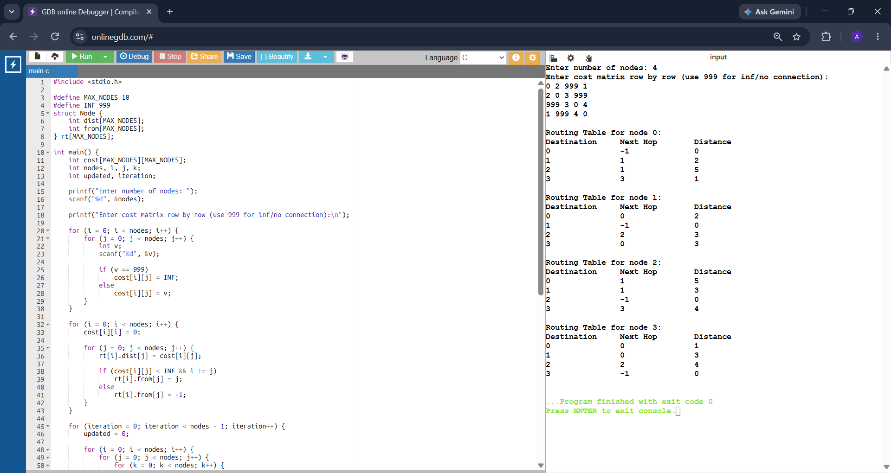
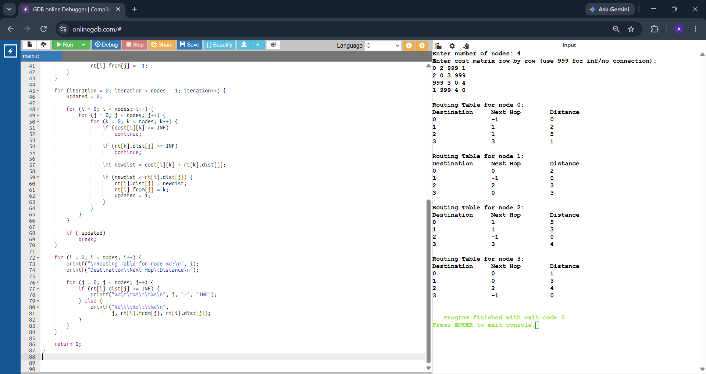

# Experiment 10: Distance Vector Algorithm

## 1. Experiment Title
Implementation of the Distance Vector Routing (DVR) Algorithm in C.

---

## 2. Aim
To design, implement, and analyze the Distance Vector Routing (DVR) algorithm in C based on the distributed Bellman-Ford algorithm. The program accepts an adjacency cost matrix for an arbitrary network graph, computes the shortest path between every pair of nodes, tracks the next-hop router for forwarding, and outputs the converged routing tables.

---

## 3. Theory / Introduction
Routing is the process by which intermediate network devices (routers) determine the optimal end-to-end path for forwarding packets from a source to a destination.

### 3.1 Routing Protocol Classifications
- **Distance Vector Protocols (e.g., Routing Information Protocol - RIP):** Each router maintains a vector of distances to every known destination and periodically shares this vector only with its directly connected immediate neighbors.
- **Link State Protocols (e.g., Open Shortest Path First - OSPF):** Each router broadcasts the status of its direct links to all routers in the entire routing area (using Dijkstra's algorithm to compute paths).

### 3.2 The Bellman-Ford Equation
Distance Vector routing relies on the Bellman-Ford dynamic programming principle:

$$D_x(y) = \min_{v \in \text{Neighbors}(x)} \{ c(x, v) + D_v(y) \}$$

Where:
- $D_x(y)$: The calculated minimum distance from node $x$ to destination node $y$.
- $c(x, v)$: The direct link cost between node $x$ and its immediate neighbor $v$.
- $D_v(y)$: The current shortest distance from neighbor $v$ to destination node $y$.

```
               (2)
        [0] ---------- [1]
         |              |
     (1) |              | (3)
         |              |
        [3] ---------- [2]
               (4)
```

### 3.3 Convergence and Routing Table Updates
1. **Initialization:** Every node initializes its distance table with direct link costs from its interface configurations. Destinations with no direct link are assigned a cost of infinity (`INF = 999`), and the next hop is set to `-1`.
2. **Iteration / Relaxation:** For each iteration (up to $N - 1$ rounds for a graph with $N$ vertices), each node inspects all neighbors $k$. If routing through neighbor $k$ yields a shorter path to destination $j$ ($c[i][k] + rt[k].dist[j] < rt[i].dist[j]$), the node updates its distance and sets `from[j] = k`.
3. **Early Termination:** If a complete round passes without any table updates (`updated == 0`), the network has converged, and the algorithm halts early.

---

## 4. Objectives
1. Implement the Bellman-Ford relaxation equation for network routing.
2. Construct and update dynamic routing tables containing Destination, Next Hop, and Metric Distance.
3. Observe iterative route convergence across an arbitrary network topology.
4. Analyze the count-to-infinity problem and routing loop prevention techniques.

---

## 5. Required Software and Tools
- **Language:** C (Standard C99/C11).
- **Compiler:** GCC (GNU Compiler Collection).
- **Platforms:** Linux, WSL, macOS, Windows, or Online C Compilers.

---

## 6. Algorithm / Working Principle
1. Start the program.
2. Read the total number of network nodes (`nodes`).
3. Read the $N \times N$ link cost matrix `cost[i][j]`. A value of `999` denotes infinity (no direct link).
4. Initialize the routing table for every node $i$:
   - Set `cost[i][i] = 0`.
   - For all destinations $j$:
     - `rt[i].dist[j] = cost[i][j]`.
     - If `cost[i][j] < INF` and `i != j`, set `rt[i].from[j] = j` (direct connection).
     - Else, set `rt[i].from[j] = -1`.
5. Perform Bellman-Ford iterations for `iteration = 0` to `nodes - 2`:
   - Set flag `updated = 0`.
   - For each node $i$:
     - For each destination $j$:
       - For each neighbor $k$:
         - If `cost[i][k] >= INF` or `rt[k].dist[j] >= INF`, skip.
         - Calculate `newdist = cost[i][k] + rt[k].dist[j]`.
         - If `newdist < rt[i].dist[j]`:
           - Update distance: `rt[i].dist[j] = newdist`.
           - Update next hop: `rt[i].from[j] = k`.
           - Set `updated = 1`.
   - If `!updated`, break early (convergence achieved).
6. Print the converged routing table for every node, listing Destination, Next Hop, and Distance.
7. End the program.

---

## 7. Implementation Details
The simulation code is located in [distance_vector.c](file:///C:/Users/Dipali/Downloads/cn%20lab/Computer-Networks-Lab/Experiment-10-Distance-Vector/distance_vector.c).

- **Maximum Nodes (`MAX_NODES`):** 10
- **Infinity Constant (`INF`):** 999
- **Data Structure:**
  ```c
  struct Node {
      int dist[MAX_NODES];
      int from[MAX_NODES];
  } rt[MAX_NODES];
  ```

---

## 8. Source Code Explanation
- `struct Node rt[MAX_NODES]`: Stores the independent routing table for each node in the network.
- `cost[i][k] + rt[k].dist[j]`: Core Bellman-Ford cost evaluation through candidate intermediate neighbor $k$.
- `rt[i].from[j] = k`: Records the next-hop interface router that must receive forwarded packets destined for node $j$.
- Convergence optimization (`if (!updated) break;`): Halts execution as soon as the network stabilizes, avoiding unnecessary redundant loops.

---

## 9. Step-by-Step Execution Instructions

### Step 1: Open Terminal
Navigate to the experiment directory:
```bash
cd Experiment-10-Distance-Vector
```

### Step 2: Compile the Code
Compile with `gcc`:
```bash
gcc distance_vector.c -o distance_vector
```

### Step 3: Run the Program
Launch the executable:
```bash
./distance_vector
```

---

## 10. Sample Input
Network of 4 nodes (0, 1, 2, 3) with link costs:
- Cost(0, 1) = 2, Cost(0, 3) = 1
- Cost(1, 2) = 3
- Cost(2, 3) = 4

Enter the matrix row by row:
```text
4
0 2 999 1
2 0 3 999
999 3 0 4
1 999 4 0
```

---

## 11. Expected Output

```text
Routing Table for node 0:
Destination	Next Hop	Distance
0	-1	0
1	1	2
2	1	5
3	3	1

Routing Table for node 1:
Destination	Next Hop	Distance
0	0	2
1	-1	0
2	2	3
3	0	3

Routing Table for node 2:
Destination	Next Hop	Distance
0	1	5
1	1	3
2	-1	0
3	3	4

Routing Table for node 3:
Destination	Next Hop	Distance
0	0	1
1	0	3
2	2	4
3	-1	0
```

### Screenshot References



---

## 12. Output Explanation
- **Node 0 $\rightarrow$ Node 2:** The direct link does not exist (`999`). Path via Node 1 costs $2 + 3 = 5$ (next hop = 1). Path via Node 3 costs $1 + 4 = 5$. The algorithm selects neighbor 1 with a shortest distance of 5.
- **Node 1 $\rightarrow$ Node 3:** Directly unconnected (`999`). Path via Node 0 costs $c(1,0) + d_0(3) = 2 + 1 = 3$. The next hop is assigned to Node 0 with total distance 3.
- **Convergence:** The routing tables reflect the optimal global shortest paths computed solely through localized iterative neighbor exchanges.

---

## 13. Result / Conclusion
The Distance Vector Routing algorithm was successfully implemented in C using the Bellman-Ford algorithm. The simulation verified autonomous distributed path discovery, routing table convergence, next-hop recording, and shortest path calculation across all network nodes.

---

## 14. Important Viva Questions with Answers

### Q1: What is the Count-to-Infinity problem in Distance Vector routing?
**Answer:** When a link fails, bad news travels slowly in Distance Vector routing. Adjacent routers may mistakenly believe their neighbor still has an alternate path to the disconnected destination, creating a routing loop where metric distance values increment continuously until reaching infinity (e.g. 16 in RIP).

### Q2: How does the Split Horizon rule mitigate routing loops?
**Answer:** The Split Horizon rule states that a router must never advertise a route back out through the same physical interface from which it originally learned that route, preventing two adjacent routers from bouncing packets back and forth.

### Q3: What is Poison Reverse?
**Answer:** Poison Reverse is an enhancement to Split Horizon. Instead of withholding routes learned from a neighbor, the router explicitly advertises those routes back to the neighbor with an infinite metric (e.g., metric = 16 in RIP), immediately invalidating any circular dependency.

### Q4: Compare Distance Vector Routing (DVR) with Link State Routing (LSR).
**Answer:**
- **DVR:** Uses the Bellman-Ford algorithm. Routers send their entire routing table only to direct neighbors periodically. Slower convergence, vulnerable to loops, but low computational overhead.
- **LSR:** Uses Dijkstra's algorithm. Routers flood link state advertisements (LSAs) describing only their immediate links to the entire network upon state changes. Fast convergence, no loops, but higher CPU and memory utilization.

### Q5: What is the maximum hop count allowed in RIP, and why?
**Answer:** The Routing Information Protocol (RIP) caps the maximum hop count at **15**. A metric value of **16 denotes infinity** (unreachable). This small limit boundaries the time required to detect network partitions and prevents infinite looping during convergence.
