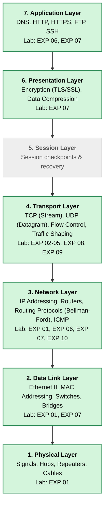

<div align="center">

<h1>🌐 Computer Networks Laboratory</h1>

<p>
  <strong>• Computer Networks Practical Experiments •</strong>
</p>

<p>
  
  
  
  
</p>

</div>

---

### 🌐 Computer Networks Lab

Basic Networking Elements → Socket Programming (TCP/UDP) → DNS & ICMP Diagnostics → Wireshark Packet Inspection → Flow Control & Traffic Shaping → Distance Vector Routing

This repository contains the laboratory work for the **Computer Networks Laboratory** course. It includes practical implementations in **C (POSIX Sockets)**, terminal network diagnostics, deep packet analysis using **Wireshark**, along with clean source code, execution screenshots, and experiment-wise documentation.

Each experiment is organized in its own folder so that programs, theoretical principles, and documentation remain easy to navigate.

---

## 👩‍💻 Author

|                     |                           |
| ------------------- | ------------------------- |
| **Name**            | **Ananya Marghade**       |
| **PRN**             | **24070521004**           |
| **Section**         | **A**                     |
| **Batch**           | **A1**                    |
| **Course**          | **Computer Networks Lab** |

---

## 🛠️ Technologies Used

|          Technology         | Purpose                                       |
| :-------------------------: | --------------------------------------------- |
|         **C / GCC**         | Socket programming, simulation and routing    |
|   **POSIX Berkeley Sockets**| Connection-oriented TCP & connectionless UDP  |
|        **Wireshark**        | Protocol dissection & live packet capture     |
|   **Terminal Diagnostics**  | `nslookup`, `ping`, `ipconfig`, `tracert`     |
| **Ubuntu / Linux / WSL**    | Build and runtime networking environment      |

### Core Concepts Covered

* OSI reference model & TCP/IP protocol suite
* Physical & data link devices (Hub, Switch, Bridge, Repeater, NIC)
* Network & transport devices (Router, Layer 3 Switch, Gateway)
* Collision domains vs. broadcast domains
* Stream sockets (`SOCK_STREAM`) & TCP 3-way handshake
* Datagram sockets (`SOCK_DGRAM`) & connectionless communication
* Domain Name System (DNS) forward and reverse PTR lookups
* Packet Internet Groper (`ping`) and ICMP error signaling
* Wireshark protocol dissection and display filtering
* Plaintext HTTP vs. TLS/HTTPS cryptographic security
* Sliding Window flow control (Go-Back-N mechanism)
* Traffic shaping algorithms (Leaky Bucket & Token Bucket)
* Distance Vector Routing and Bellman-Ford algorithm

---

## 📚 Experiment Index

|   No.  | Experiment                                                 | Source Code                                | Documentation                                        |
| :----: | ---------------------------------------------------------- | ------------------------------------------ | :--------------------------------------------------: |
| **01** | Basic Networking Elements and Devices                      | Architectural Study                        | [📖 README](Experiment-01-Basic-Networking/README.md) |
| **02** | TCP Server Socket Programming                              | `tcp_server.c`                             | [📖 README](Experiment-02-TCP-Server/README.md)      |
| **03** | TCP Client Socket Programming                              | `tcp_client.c`                             | [📖 README](Experiment-03-TCP-Client/README.md)      |
| **04** | UDP Server Socket Programming                              | `udp_server.c`                             | [📖 README](Experiment-04-UDP-Server/README.md)      |
| **05** | UDP Client Socket Programming                              | `udp_client.c`                             | [📖 README](Experiment-05-UDP-Client/README.md)      |
| **06** | DNS Commands Using Terminal                                | Command Reference                          | [📖 README](Experiment-06-DNS-Commands/README.md)    |
| **07** | DNS and HTTPS Packet Analysis Using Wireshark              | Packet Dissection                          | [📖 README](Experiment-07-Wireshark-Analysis/README.md) |
| **08** | Sliding Window Protocol                                    | `sliding_window.c`                         | [📖 README](Experiment-08-Sliding-Window/README.md)   |
| **09** | Traffic Shaping Algorithms (Leaky & Token Bucket)          | `leaky_bucket.c`, `token_bucket.c`         | [📖 README](Experiment-09-Traffic-Shaping/README.md) |
| **10** | Distance Vector Routing Algorithm                          | `distance_vector.c`                        | [📖 README](Experiment-10-Distance-Vector/README.md) |

---

## 📂 Repository Layout

```text
Computer-Networks-Lab/
│
├── README.md
│
├── Experiment-01-Basic-Networking/
│   └── README.md
│
├── Experiment-02-TCP-Server/
│   ├── README.md
│   └── tcp_server.c
│
├── Experiment-03-TCP-Client/
│   ├── README.md
│   └── tcp_client.c
│
├── Experiment-04-UDP-Server/
│   ├── README.md
│   └── udp_server.c
│
├── Experiment-05-UDP-Client/
│   ├── README.md
│   └── udp_client.c
│
├── Experiment-06-DNS-Commands/
│   └── README.md
│
├── Experiment-07-Wireshark-Analysis/
│   └── README.md
│
├── Experiment-08-Sliding-Window/
│   ├── README.md
│   └── sliding_window.c
│
├── Experiment-09-Traffic-Shaping/
│   ├── README.md
│   ├── leaky_bucket.c
│   └── token_bucket.c
│
└── Experiment-10-Distance-Vector/
    ├── README.md
    └── distance_vector.c
```

---

## 🔎 Protocol & Networking Layer Coverage

| Layer | Protocol / Concept | Demonstrated In |
|---|---|---|
| **Layer 1: Physical** | Hub, Repeater, Modem, Transmission Media | Experiment 01 |
| **Layer 2: Data Link** | Switch, Bridge, NIC, MAC Addressing, Frame Filtering | Experiment 01, Experiment 07 |
| **Layer 3: Network** | IPv4, Router, Subnetting, Distance Vector Routing (Bellman-Ford), ICMP (`ping`, `tracert`) | Experiment 01, Experiment 06, Experiment 07, Experiment 10 |
| **Layer 4: Transport** | TCP Stream Sockets (`SOCK_STREAM`), UDP Datagram Sockets (`SOCK_DGRAM`), Flow Control (Sliding Window), Congestion Control (Traffic Shaping) | Experiment 02, Experiment 03, Experiment 04, Experiment 05, Experiment 07, Experiment 08, Experiment 09 |
| **Layer 7: Application** | DNS (`nslookup`), HTTP, HTTPS / TLS Encrypted Data | Experiment 06, Experiment 07 |

---

## 🔄 TCP vs. UDP Socket Architecture

```text
             TCP (Connection-Oriented)                 UDP (Connectionless)
             
       Server                    Client            Server                Client
         │                         │                 │                     │
      socket()                  socket()          socket()              socket()
         │                         │                 │                     │
       bind()                      │               bind()                  │
         │                         │                 │                     │
      listen()                     │                 │                     │
         │       3-way handshake   │                 │                     │
      accept() <──────────────── connect()           │                     │
         │                         │                 │                     │
      read()   <────────────────  send()          recvfrom() <────────── sendto()
         │                         │                 │                     │
      send()   ────────────────>  read()          sendto()   ──────────> recvfrom()
         │                         │                 │                     │
      close()  <── 4-way close ──> close()         close()                 close()
```

---

## 🧱 The 7 Layers of the OSI Model

The Open Systems Interconnection (OSI) model standardizes the communication functions of a telecommunication or computing system across seven abstraction layers. The practical experiments in this laboratory map across these layers:



---

## 📈 Learning Progress

```text
Basic Networking & Hardware Elements
                 │
                 ▼
TCP Socket Programming (Server & Client)
                 │
                 ▼
UDP Socket Programming (Server & Client)
                 │
                 ▼
Terminal Network Diagnostics (DNS & ICMP)
                 │
                 ▼
Wireshark Packet Capture & Analysis
                 │
                 ▼
Flow Control (Sliding Window Protocol)
                 │
                 ▼
Traffic Shaping (Leaky Bucket & Token Bucket)
                 │
                 ▼
Distance Vector Routing (Bellman-Ford Algorithm)
```

---

<div align="center">

### 🌐 Computer Networks Lab

**Socket Programming • Packet Analysis • Routing Algorithms • Network Protocols • C**

<br>

**Ananya Marghade**  
PRN: 24070521004 • A / A1 • 2024–28

</div>
